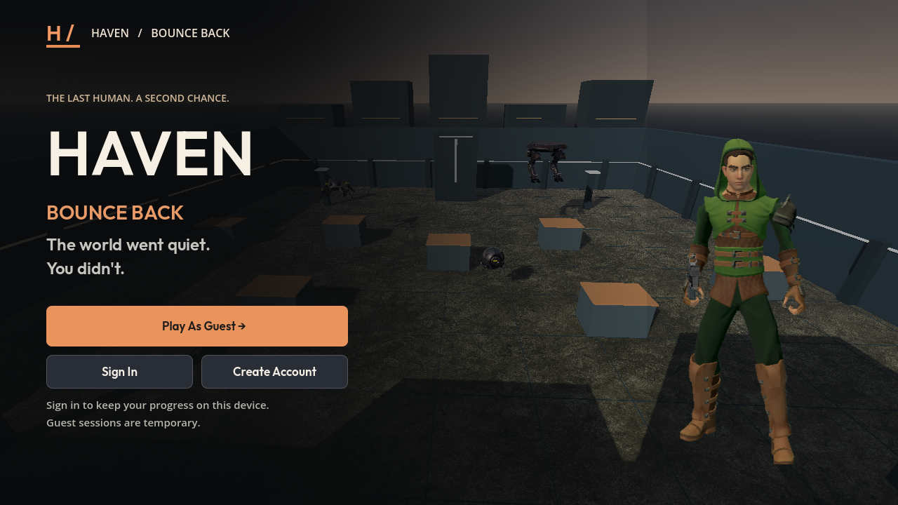
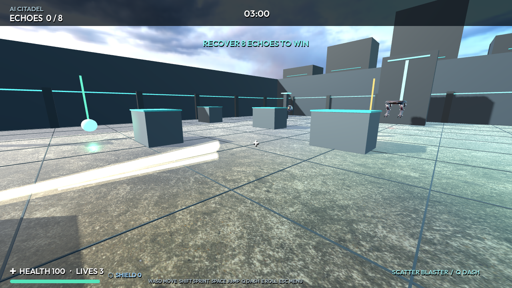
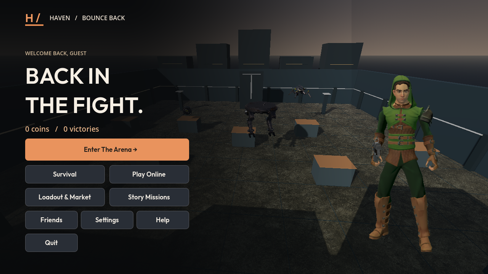

# Environment and human-character update

The forest and desert have been rebuilt using premade Poly Haven scanned scenery. The three human appearances now use Quaternius Universal Base Characters and the matching animation library. These are asset-based arena layouts; complete maps were not downloaded.

- Forest: wind-driven trees and undergrowth, scanned cover, softer atmospheric depth, and three foxes using their native Walk animation on decorative perimeter routes.
- Desert: scanned rocky escarpments and cover, cracked-earth ground, ribbed cacti and warm directional lighting.
- Characters: adult proportions, textured faces and hair, premade layered outfits and different hairstyles, skeletal idle/run/jump/roll/shoot animations.
- Existing home-page layout and gameplay modes remain available. Combat boundaries are still 50 × 50 metres. Wildlife is scenery, not an enemy or companion system.

## Accounts

The opening screen now offers Sign up, Sign in and Play as guest. Signed-in progress persists on this computer: name, ID, coins, unlocks, gear, story progress, friends and settings. Guest sessions are temporary and isolated. The previous reset-on-every-launch behaviour has been removed. Google sign-in and cross-device saves are not connected.

## Weapon effects

Shots have a bright core, layered tracer trail, muzzle flash and short-lived impact sparks. Local scatter fire displays seven pellets. Damage remains raycast-based; the moving streak is visual feedback. The effects capture below uses a side inspection camera and frozen in-flight effects to make the short-lived tracer geometry visible.

## In-game captures

## Validation

Godot 4.6.3 import and automated gameplay checks passed: all five arenas, all three avatar animation sets, movement, shooting, pickups, purchases and survival waves. Account tests verify persistent signed-in progress and temporary guests. A local host/client multiplayer test passed. The screens above were rendered in Godot's Compatibility renderer using software rendering; they are actual game captures. Hardware GPU performance and internet multiplayer have not been benchmarked in this update.

Asset sources, licences and modifications: [ASSET_CREDITS.md](ASSET_CREDITS.md).

## Opening screen and enemy behaviour

The opening screen and lobby now use warm ivory type, charcoal controls and burnt-orange primary actions over a live 3D arena. Ground robots pursue on a shared clearance grid and use their native running clips. Pursuers close the gap, flankers reposition, and cover blocks their attacks. Reaction windows and difficulty settings remain in place.
