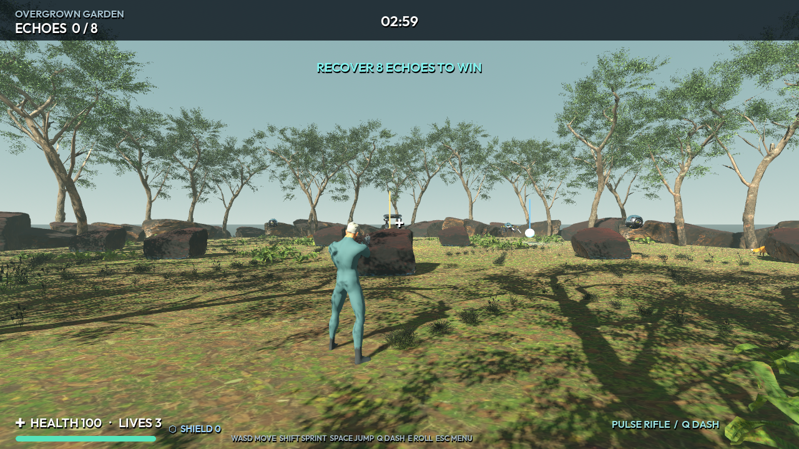
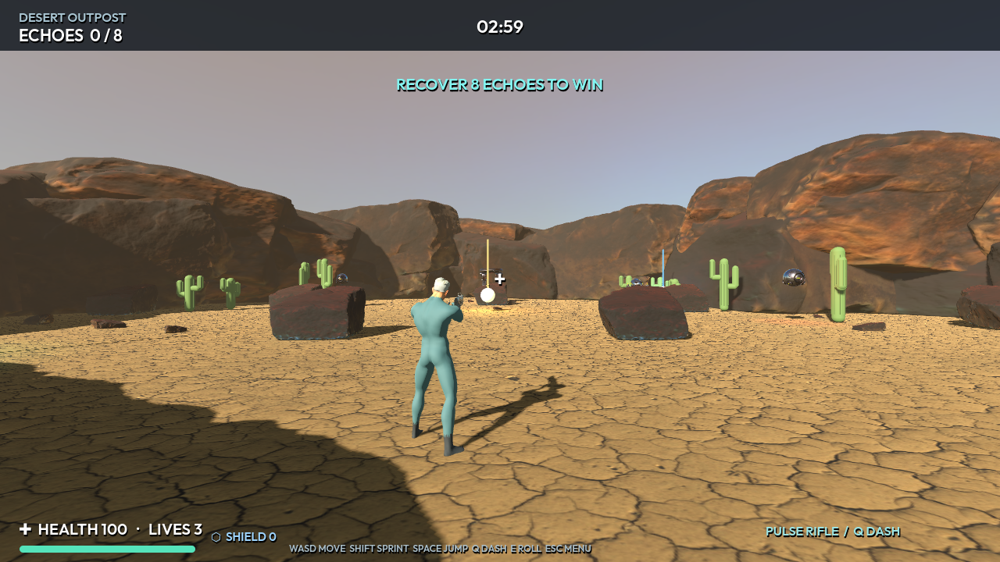

# Environment and human-character update

The forest and desert have been rebuilt using premade Poly Haven scanned scenery. The three human appearances now use Quaternius Universal Base Characters and the matching animation library. These are asset-based arena layouts; complete maps were not downloaded.

- Forest: wind-driven trees and undergrowth, scanned cover, softer atmospheric depth, and three foxes using their native Walk animation on decorative perimeter routes.
- Desert: scanned rocky escarpments and cover, cracked-earth ground, ribbed cacti and warm directional lighting.
- Characters: adult proportions, textured faces and hair, different suit colours and hairstyles, skeletal idle/run/jump/roll/shoot animations.
- Existing home-page layout and gameplay modes remain available. Combat boundaries are still 50 × 50 metres. Wildlife is scenery, not an enemy or companion system.

## In-game captures

## Validation

Godot 4.6.3 import and automated gameplay checks passed: all five arenas, all three avatar animation sets, movement, shooting, pickups, purchases, survival waves and restart reset. A local host/client multiplayer test passed. The screens above were rendered in Godot's Compatibility renderer using software rendering; they are actual game captures. Hardware GPU performance and internet multiplayer have not been benchmarked in this update.

Asset sources, licences and modifications: [ASSET_CREDITS.md](ASSET_CREDITS.md).
